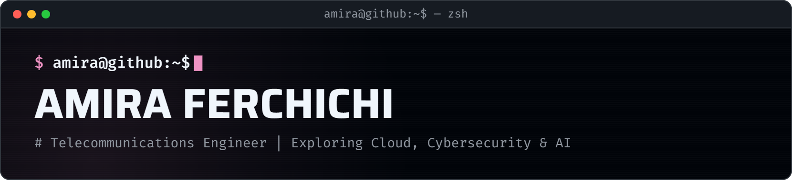

<!-- ═══════════════════════════════════════════════════════════════ -->
<!--                    AMIRA FERCHICHI | GITHUB                    -->
<!-- ═══════════════════════════════════════════════════════════════ -->

  <!-- Custom Dark Banner -->
  

   

  <h1>Hey, I'm Amira 👋</h1>

  <h3>ICT Engineer · Tech Enthusiast · Lifelong Learner</h3>

  

    

  <!-- GitHub Badges -->

  

  

  

    

---

<!-- ═════════════════════════════ ABOUT ME ═════════════════════════════ -->

<h2 align="center">About Me</h2>

I'm **Amira Ferchichi**, an ICT Engineer specializing in **Telecommunications**, passionate about technology, innovation, and solving real-world problems.

- 🎓 ICT Engineering — National Engineering School of Tunis (ENIT).
- ☁️ Interested in Cloud Computing and Cloud Infrastructure.
- 🤖 Exploring Artificial Intelligence, Machine Learning, and LLMs.
- 🔐 Passionate about Cybersecurity and Network Security.
- 💻 Interested in Software Engineering and building practical solutions.
- 🚀 Always learning, experimenting, and exploring new technologies.

**Areas of Interest:**

Cloud Computing · Artificial Intelligence · Cybersecurity · Telecommunications

---

<!-- ═════════════════════════════ TECH STACK ═════════════════════════════ -->

<h2 align="center">Tech Stack</h2>

### 💻 Programming Languages

### 🌐 Web Development

### ☁️ Cloud & DevOps

### 🤖 AI & Data Science

### 🔐 Cybersecurity & Networking

### 🛠️ Tools & Platforms

---

<!-- ═════════════════════════════ GITHUB ANALYTICS ═════════════════════════════ -->

<h2 align="center">GitHub Analytics</h2>

<!-- GitHub Statistics -->

<!-- Top Languages -->

  

<!-- GitHub Streak -->

  

<!-- GitHub Activity Graph -->

---

<!-- ═════════════════════════════ CONTRIBUTION SNAKE ═════════════════════════════ -->

<h2 align="center">Contribution Garden 🌸</h2>

<picture>
  <source media="(prefers-color-scheme: dark)" srcset="https://raw.githubusercontent.com/Amira-ferchichi-9/Amira-ferchichi-9/output/github-contribution-grid-snake-dark.svg">
  <source media="(prefers-color-scheme: light)" srcset="https://raw.githubusercontent.com/Amira-ferchichi-9/Amira-ferchichi-9/output/github-contribution-grid-snake.svg">
  
</picture>

<!--
Create this workflow at:
.github/workflows/snake.yml

name: Generate Contribution Snake

on:
  schedule:
    - cron: "0 0 * * *"
  workflow_dispatch:
  push:
    branches:
      - main

permissions:
  contents: write

jobs:
  generate:
    runs-on: ubuntu-latest
    steps:
      - name: Generate Snake
        uses: Platane/snk@v3
        with:
          github_user_name: Amira-ferchichi-9
          outputs: |
            dist/github-contribution-grid-snake.svg
            dist/github-contribution-grid-snake-dark.svg?palette=github-dark

      - name: Deploy Snake
        uses: crazy-max/ghaction-github-pages@v4
        with:
          target_branch: output
          build_dir: dist
        env:
          GITHUB_TOKEN: ${{ secrets.GITHUB_TOKEN }}

After creating the workflow:
Repository → Actions → Generate Contribution Snake → Run workflow.
-->

---

<!-- ═════════════════════════════ CONNECT ═════════════════════════════ -->

<h2 align="center">Let's Connect</h2>

---

<!-- ═════════════════════════════ FOOTER ═════════════════════════════ -->

  

  © Amira Ferchichi · Built with passion and curiosity.

